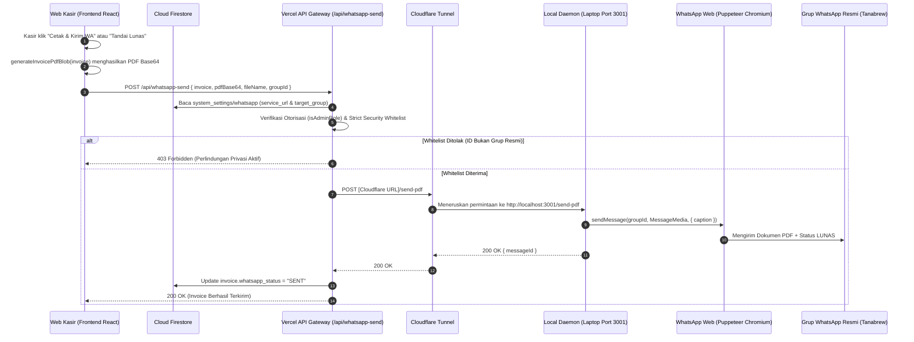

# Arsitektur & Panduan Integrasi Otomasi WhatsApp Tanabrew

Dokumen ini adalah **panduan teknis resmi (*technical whitepaper & runbook*)** untuk sub-sistem otomatisasi pengiriman faktur PDF melalui WhatsApp di **Tanabrew Stock & Invoice**.

---

## 🏛️ 1. Gambaran Umum & Mengapa Arsitektur Hybrid?

WhatsApp tidak menyediakan API resmi gratis untuk pengiriman dokumen via nomor pribadi kasir tanpa biaya langganan bisnis bulanan (*WhatsApp Cloud API / BSP*). Solusi open-source yang andal menggunakan **Chrome Headless Engine (*whatsapp-web.js*)**, namun pustaka ini membutuhkan peramban Chromium aktif secara terus-menerus (*persistent stateful session*) untuk menyimpan sesi enkripsi `IndexedDB`.

### Tantangan Lingkungan Cloud (Vercel Serverless):
* Vercel Serverless Function bersifat **stateless** dengan batas waktu eksekusi (*timeout*) maksimal 10–15 detik pada paket Hobby.
* Vercel tidak dapat menjalankan browser Chromium di latar belakang 24/7.
* Paket Vercel Hobby memiliki batas ketat maksimal **12 Serverless Functions** per deployment.

### Solusi Arsitektur Hybrid Edge-Cloud:
Aplikasi Tanabrew memisahkan tugas menjadi dua lapisan:
1. **Cloud Gateway (Vercel Serverless)**:
   - Berperan sebagai API Gateway ringan yang menerima permintaan dari antarmuka Web POS kasir.
   - Mengambil data invoice dari Firestore, memverifikasi hak akses pengguna, memeriksa whitelist grup, dan meneruskan *payload* PDF ke laptop kasir.
2. **Local Worker Daemon (Laptop Kasir)**:
   - Berjalan secara mandiri di laptop kasir (`whatsapp-service/` pada port `3001`).
   - Menjalankan Chromium headless dengan sesi WhatsApp Web resmi yang tersimpan di disk lokal (`.wwebjs_auth/`).
   - Dipublikasikan ke internet secara aman melalui **Cloudflare Quick Tunnel** (`cloudflared.exe`) tanpa perlu IP publik statis atau setting port forwarding pada router WiFi toko.

---

## 🔄 2. Arsitektur Komponen & Diagram Alur Data



---

## ⚠️ 3. Batas Serverless Vercel Hobby (Maksimal 12 Fungsi) & Strategi Konsolidasi API

Pada paket Vercel Hobby, **maksimal hanya 12 Serverless Function** yang diizinkan dalam satu deployment. Jika jumlah file `.ts` / `.js` di dalam direktori `api/` melebihi 12, proses deployment Vercel akan **gagal total** (*Build Error: Pada paket Hobby, maksimal hanya 12 Serverless Function yang dapat ditambahkan*).

### Daftar 9 Fungsi Serverless Aktif Saat Ini:
1. `api/cron-dispatcher.ts` (Laporan otomatis harian jam 23:00 WIB)
2. `api/cron-trigger.ts` (Pemicu manual cron)
3. `api/customer-crm.ts` (Analisis pelanggan & CRM)
4. `api/inventory-audit.ts` (Audit mutasi inventaris gudang)
5. `api/pricelist.ts` (Data price list publik)
6. `api/sales-analytics.ts` (Perhitungan analitik penjualan)
7. `api/send-notification.ts` (Push notification OneSignal)
8. `api/visitor-event.ts` (Pelacakan pengunjung web publik)
9. `api/whatsapp-send.ts` (Pengiriman faktur PDF & caption)
10. `api/whatsapp.ts` (**Endpoint Terpadu WhatsApp**)

### Konsolidasi Endpoint WhatsApp (`api/whatsapp.ts`):
Untuk menghemat kuota fungsi, seluruh operasi WhatsApp pendukung yang sebelumnya terpecah menjadi 5 file terpisah kini disatukan ke dalam satu endpoint terpadu:
* `action: "status"` (Pemeriksaan koneksi online/offline)
* `action: "config"` (Pengambilan & penyimpanan konfigurasi)
* `action: "pair-code"` (Permintaan kode pairing 8 digit)
* `action: "disconnect"` (Pemutusan sesi logout)
* `action: "sync_url"` (Sinkronisasi otomatis URL Cloudflare dari laptop ke Firestore)

> [!IMPORTANT]
> **ATURAN WAJIB BAGI DEVELOPER & AI AGENT**:
> **Dilarang keras menambah file baru di folder `api/`!** Jika membutuhkan fungsionalitas backend baru, gunakan parameter `action` pada endpoint yang sudah ada atau konsolidasikan modul terkait ke dalam file yang telah tersedia.

---

## 🛡️ 4. Whitelist Keamanan Grup & Proteksi Privasi Akun Kasir

Karena akun WhatsApp yang terhubung adalah nomor pribadi/operasional kasir, sistem dilengkapi **Guardrail Keamanan Berlapis** untuk memastikan pesan otomatis tidak akan pernah terkirim ke kontak pribadi, obrolan keluarga, atau grup di luar Tanabrew:

### Daftar Whitelist Grup Resmi:
| ID Grup WhatsApp | Nama Grup | Peruntukan |
| :--- | :--- | :--- |
| `120363406655043675@g.us` | **aniv 7 mei** | Lingkungan Uji Coba (Testing Sandbox) |
| `120363422161770936@g.us` | **Tanabrew transaksi** | Saluran Resmi Operasional Toko (Produksi) |

### Mekanisme Penguncian Ganda:
1. **Tingkat Gateway Serverless (`api/whatsapp-send.ts`)**:
   - Memvalidasi parameter `groupId`. Jika `groupId` tidak terdaftar di dalam `ALLOWED_GROUPS`, request langsung ditolak dengan status `403 Forbidden` sebelum sempat menyentuh laptop kasir.
2. **Tingkat Daemon Laptop (`whatsapp-service/src/index.ts`)**:
   - Endpoint `/groups` hanya mengembalikan grup yang berada dalam whitelist. Grup pribadi lainnya otomatis disembunyikan.
   - Endpoint `/send-pdf` memvalidasi ulang kecocokan `cleanGroupId` terhadap whitelist lokal.

---

## 🌐 5. Mekanisme Auto-Sync Tunnel Cerdas (Port 20241)

Cloudflare Quick Tunnel (`cloudflared tunnel --url http://localhost:3001`) menghasilkan domain acak baru setiap kali dijalankan (contoh: `https://predicted-anywhere-frontpage-retro.trycloudflare.com`).

Agar kasir tidak perlu menyalin dan menempel (*copy-paste*) URL tersebut ke web:
1. `cloudflared.exe` dijalankan dengan parameter `--metrics 127.0.0.1:20241`.
2. Daemon `whatsapp-service` memiliki background loop (*timer 10 detik*) yang meminta metrics lokal dari port `20241`.
3. Daemon mengekstrak hostname publik dari metrik `userHostname="..."`.
4. Jika URL terdeteksi berubah atau baru menyala, daemon langsung memanggil API cloud:
   ```http
   POST https://tanabrew-stok-and-invoice.vercel.app/api/whatsapp
   Content-Type: application/json

   { "action": "sync_url", "service_url": "https://..." }
   ```
5. URL baru disimpan di Firestore (`system_settings/whatsapp`), sehingga seluruh perangkat kasir (laptop, iPad, HP Android) otomatis terhubung tanpa konfigurasi manual ulang.

---

## 📄 6. Integritas Format Dokumen PDF & Pelunasan Faktur

### Standar Tampilan PDF (100% Identik):
Seluruh dokumen invoice, baik yang dicetak manual, diunduh, maupun dikirim via WhatsApp, dihasilkan oleh satu modul terpusat: [`src/lib/invoicePdfGenerator.ts`](file:///d:/Downloads/tanabrew-stok-and-invoice-github/src/lib/invoicePdfGenerator.ts).
* Kertas: A4 Potret (210 x 297 mm) dengan margin presisi 14 mm.
* Header: Logo Tanabrew di kiri atas (38 x 11.5 mm), nomor invoice, tanggal, pelanggan, dan gudang di kanan atas.
* Tabel Belanjaan: Header berwarna *Sage Green* (`#A5D6A7`), teks hitam pekat, batas tipis 0.2 mm.
* Rincian Pembayaran: Lebar penuh (*full width*) dengan Subtotal, Diskon, Total (Bold), Jumlah Dibayar, Sisa Pembayaran, dan Status.
* Footer: Rekening Seabank & Bank Jago a.n. AHMAD FARID MUSADDAD.

### Perilaku Saat "Tandai Lunas":
Saat faktur ditandai lunas:
1. Status invoice di Firestore diperbarui:
   - `status: "LUNAS"`
   - `jumlah_dibayar: invoice.total`
   - `sisa: 0`
   - `paid_at: serverTimestamp()`
   - `paid_by: userProfile.name`
2. Modul `generateInvoicePdfBlob` dipanggil dengan data terbarukan tersebut:
   - **Tampilan dan tata letak tidak bergeser satu pixel pun**.
   - Teks **Status** tercetak tebal dengan warna hijau resmi (`#2E7D32`) bertuliskan **LUNAS**.
   - **Jumlah Dibayar** menampilkan total lunas dan **Sisa Pembayaran** tertulis `Rp0`.
3. PDF tersebut langsung dikirim otomatis ke grup WhatsApp dengan caption:
   ```text
   📄 *INVOICE TANABREW ROASTERY*

   • *No. Invoice:* INV/TNB/2026/11/0003
   • *Customer:* Pelanggan
   • *Total:* Rp150.000
   • *Status:* 🟢 LUNAS
   • *Kasir:* Danial Gobel

   _Invoice otomatis dikirim oleh sistem Tanabrew._
   ```

---

## 👥 7. Hak Akses & Matriks Otorisasi Pengguna

Otorisasi peran pengguna wajib diverifikasi menggunakan utilitas resmi [`src/lib/roleUtils.ts`](file:///d:/Downloads/tanabrew-stok-and-invoice-github/src/lib/roleUtils.ts):

| Fitur / Aksi | Developer (`webdev`) | Owner (`owner`) | Admin (`admin`) | Staff / Kasir (`staff`) |
| :--- | :---: | :---: | :---: | :---: |
| **Buat & Cetak Invoice Baru** | ✅ | ✅ | ✅ | ✅ |
| **Kirim Invoice ke WhatsApp** | ✅ | ✅ | ✅ | ✅ |
| **Tandai Invoice Lunas** | ✅ | ✅ | ✅ | ❌ |
| **Cetak Ulang Invoice** | ✅ | ✅ | ✅ | ❌ |
| **Buka Menu Pengaturan WhatsApp** | ✅ | ✅ | ✅ | ❌ |
| **Ubah Grup Tujuan WhatsApp** | ✅ | ✅ | ❌ | ❌ |

> [!CAUTION]
> **Dilarang** menggunakan perbandingan string langsung seperti `userProfile.role !== "admin" && userProfile.role !== "owner"`. Gunakan selalu helper `isAdminRole(userProfile?.role, currentUser?.email)` agar akun Developer memiliki hak akses penuh yang konsisten.

---

## ❄️ 8. Manajemen Performa, Daya, & Suhu Laptop (Anti-Overheat)

WhatsApp daemon dirancang agar hemat daya dan tidak membebani prosesor laptop kasir:
1. **Tidak Ada Auto-Start Saat Booting**:
   - Layanan tidak didaftarkan ke Windows Startup registry atau task scheduler agar laptop tidak bekerja keras saat baru dinyalakan.
   - Layanan dijalankan hanya saat toko buka melalui shortcut desktop.
2. **Profil Daya Seimbang (Windows Balanced Power Plan)**:
   - Jangan menyetel laptop ke mode "High Performance". Biarkan di mode **Balanced** agar prosesor otomatis melakukan *downclock* ke frekuensi 1–2 GHz (konsumsi daya hanya 5–10 Watt) saat menunggu antrean invoice. Suhu laptop tetap dingin di kisaran 38°C–45°C.
3. **Layar Mati vs Laptop Tidur (Sleep)**:
   - **Layar Mati (*Turn off display*)**: Sangat aman! Mematikan lampu layar justru membuat laptop semakin dingin dan hemat baterai, sementara CPU, Wi-Fi, dan server WhatsApp tetap aktif 100%.
   - **Laptop Tidur (*Sleep*)**: Wajib dicegah saat colok charger (*Sleep timeout: Never*) agar koneksi socket WhatsApp tidak terputus.

---

## 🖥️ 9. Panduan Operasional Harian & Shortcut Desktop

Tiga shortcut resmi telah dipasang pada Desktop pengguna (`C:\Users\acer\OneDrive\Desktop`):

### 1. `Nyalakan WhatsApp Tanabrew.lnk`
* **Fungsi**: Menyalakan server Node.js di port 3001 dan Cloudflare Tunnel secara terminimalkan (*minimized*).
* **Target**: `whatsapp-service/scripts/start-service.bat`
* **Waktu Eksekusi**: ~3 detik. Begitu selesai, jendela otomatis tertutup dan web kasir langsung terhubung.

### 2. `Cek Status WhatsApp Tanabrew.lnk`
* **Fungsi**: Membuka terminal interaktif berbasis PowerShell untuk memeriksa:
  - Port 3001 (Online / Offline).
  - Status autentikasi WhatsApp (Terhubung 🟢 / Belum Login).
  - Status Cloudflare Tunnel dan URL publik aktif.
* **Target**: `whatsapp-service/scripts/status-service.bat`

### 3. `Matikan WhatsApp Tanabrew.lnk`
* **Fungsi**: Menghentikan proses Node.js dan `cloudflared.exe` seketika serta membebaskan memori RAM saat toko tutup.
* **Target**: `whatsapp-service/scripts/stop-service.bat`

---

## 🔧 10. Catatan Teknis & Patching Pustaka (`patch-wwebjs.js`)

Pustaka `whatsapp-web.js` (versi `1.26.0`) memerlukan penyesuaian (*hotpatch*) agar kompatibel dengan versi terbaru WhatsApp Web modern:
1. **Penanganan `Conn.serialize()`**:
   - WhatsApp Web modern mengubah model `Conn`, menyebabkan error fatal saat proses serialisasi status.
   - Skrip `scripts/patch-wwebjs.js` menyematkan blok `try/catch` pada `Client.js` agar event `ready` dan `authenticated` tetap terpicu mulus.
2. **Eliminasi Properti Privat `__x_id` pada Getter Memoize**:
   - Model pesan WhatsApp melempar peringatan *"Data passed to getter must include an id property"* saat mengirim media.
   - Patch memastikan objek `MessageMedia` bersih sebelum diserahkan ke Puppeteer.
3. **Eksekusi Otomatis**:
   - Skrip patching didaftarkan pada hook `"postinstall"` di `whatsapp-service/package.json` sehingga otomatis dieksekusi setelah perintah `npm install`.

---

## ❓ 11. Troubleshooting & Masalah Umum (FAQ)

### Q: Di web muncul peringatan "WhatsApp Belum Terhubung"?
**Solusi**:
1. Pastikan Anda sudah mengklik shortcut **`Nyalakan WhatsApp Tanabrew`** di desktop.
2. Klik tombol **`Muat Ulang`** pada modal WhatsApp di web kasir.
3. Jika masih belum terhubung, klik shortcut **`Cek Status WhatsApp Tanabrew`** di desktop, lalu salin URL publik yang tampil dan tempelkan ke kolom *Alamat Server WhatsApp (Laptop)* di web kasir.

### Q: Laptop kasir terputus dari internet atau ganti WiFi?
**Solusi**:
Cloudflare Tunnel akan otomatis mencoba menyambung ulang (*auto-reconnect*). Jika IP atau jaringan berubah drastis:
1. Klik shortcut **`Matikan WhatsApp Tanabrew`**.
2. Tunggu 5 detik, lalu klik shortcut **`Nyalakan WhatsApp Tanabrew`**. URL baru akan otomatis terdaftar ke cloud dalam hitungan detik.

### Q: Sesi WhatsApp logout sendiri?
**Solusi**:
1. Klik shortcut **`Cek Status WhatsApp Tanabrew`**. Jika berstatus *"Menunggu Penautan"*, buka modal WhatsApp di web kasir.
2. Masukkan nomor HP kasir untuk menerima **Kode Pairing 8 Digit** atau scan QR Code yang muncul di layar.
